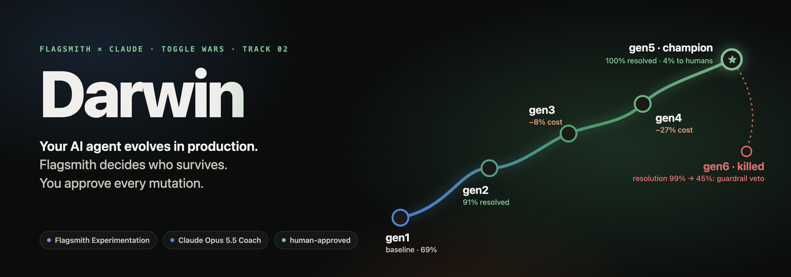
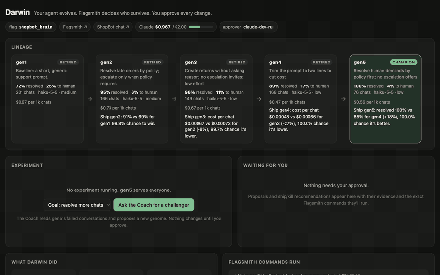
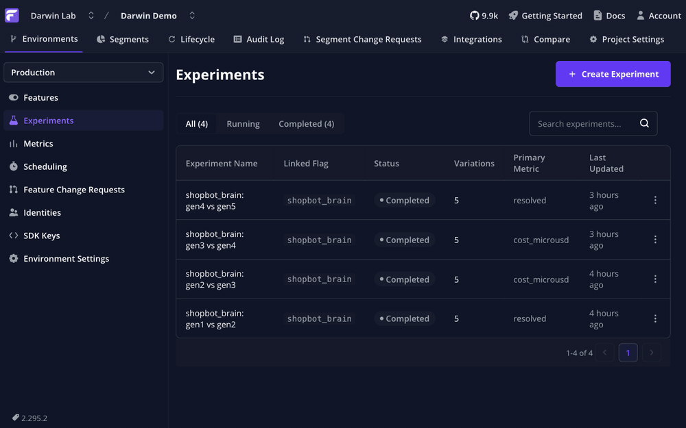
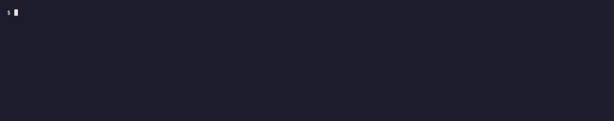
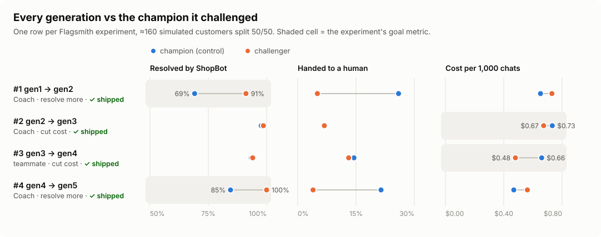
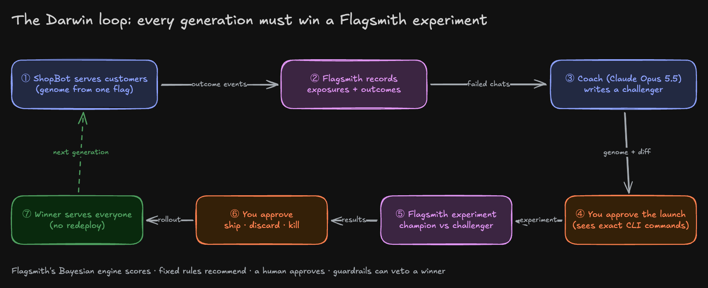
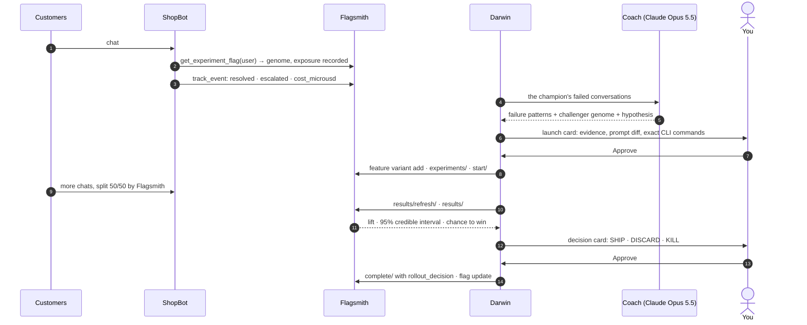
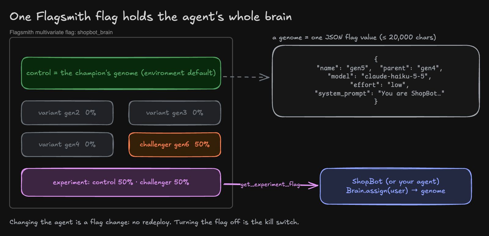
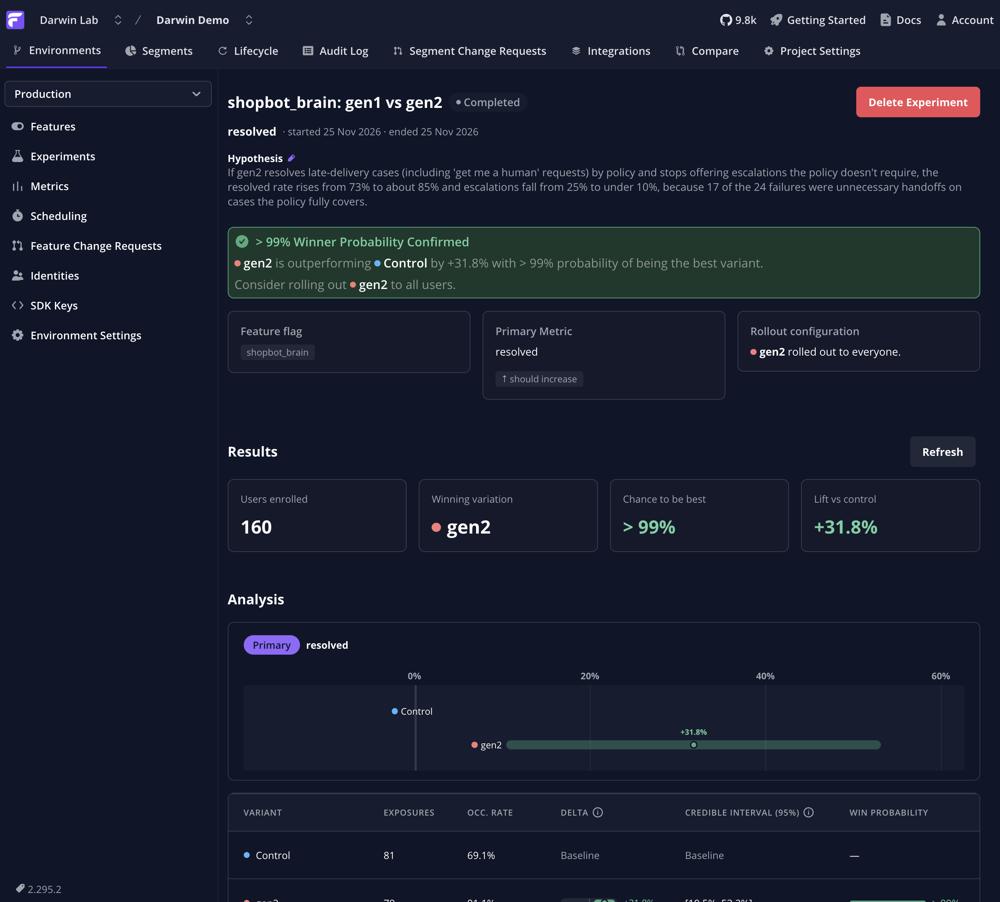
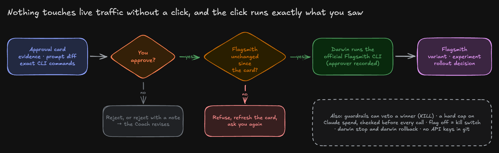

<p align="center">
  
</p>

<p align="center">
  <a href="https://github.com/anugrah55/darwin/actions/workflows/test.yml"></a>
  
  
  
  
  
</p>

<p align="center"><b>Toggle Wars (WeMakeDevs × Flagsmith) · Track 02: AI Agents and Feature Flags</b></p>

---

Darwin keeps an AI agent's whole configuration (its system prompt, model and effort) in **one Flagsmith multivariate
flag**. A Coach agent reads the conversations the agent got wrong and writes a challenger. **Flagsmith Experimentation**
runs champion against challenger on live traffic, and its Bayesian engine says who is better. Fixed rules turn those
numbers into a recommendation (ship, discard or kill), and **nothing touches live traffic until a human approves** a
card that shows the exact Flagsmith CLI commands it will run.

▶️ **Demo video:** _coming_ · 🧪 **[Lab notebook from our run](LAB_NOTEBOOK.md)** · 🧬 **[Editable diagrams](docs/diagrams/)**

## 🎬 The 60-second tour

<p align="center"></p>

<p align="center"><sub><b>Darwin Lab.</b> Five generations, each judged by a Flagsmith experiment. At the end, a real gen1 failure:
ShopBot fixed the late order, then offered “a specialist” anyway, the customer said yes, and a human got a solved
ticket. The Coach found that pattern in 8 chats.</sub></p>

<table>
<tr>
<td width="50%">99% winner, +31.8% lift, gen2 rolled out to everyone"></td>
<td width="50%"></td>
</tr>
<tr>
<td><sub><b>Flagsmith does the judging.</b> The experiment Darwin created, with the Coach's hypothesis,
“&gt;99% winner probability” and “gen2 rolled out to everyone”.</sub></td>
<td><sub><b>Or drive it from the terminal.</b> <code>darwin status</code> shows the lineage;
<code>darwin spend</code> shows Claude spend against the hard cap.</sub></td>
</tr>
</table>

## 📈 What happened in our run

ShopBot is a customer-support agent (Claude Haiku 5.5) for an imaginary outdoor store, and its brain lives in the flag
`shopbot_brain`. Five generations ran on a local Flagsmith 2.295.2. Every row is one Flagsmith experiment: **about 160
fresh customers split 50/50**, with the numbers taken from Flagsmith's results.

<picture>
  <source media="(prefers-color-scheme: dark)" srcset="docs/img/results-dark.svg">
  
</picture>

| Generation | Written by | Goal | What Flagsmith measured (challenger vs champion) | Decision |
|---|---|---|---|---|
| gen1 | baseline | – | 73% of chats resolved, 25% handed to a human (120 chats) | – |
| gen2 | 🤖 Coach | resolve more | **resolved 91% vs 69%** · lift +32% (95% CI +10% … +53%) · 99.8% chance to win · cost +12% | ✅ shipped |
| gen3 | 🤖 Coach | cut cost | **cost per chat −8%** (95% CI −14% … −2%) · resolution unchanged (+1%, CI −3% … +5%) | ✅ shipped |
| gen4 | 🧑 teammate | cut cost | **cost per chat −27%** (95% CI −32% … −23%) · resolution unchanged (+1%, CI −7% … +9%) | ✅ shipped |
| gen5 | 🤖 Coach | resolve more | **resolved 100% vs 85%** · lift +18% (95% CI +7% … +29%) · 100% chance to win · cost +20% | ✅ shipped |

From gen1 to gen5, chats handed to a human fell from **25% to 4%** and resolution rose from **about 70% to 100%**, while
gen5 still costs less per chat than gen1 ($0.00056 vs $0.00065). Those end-to-end figures compare different
experiments, so read them as indicative; each row is a controlled comparison.

- **The Coach found the real problems.** Reading 28 failed chats, it saw gen1 escalate angry customers on their first
  request (×9) and offer "a specialist" after it had already fixed the problem (×8). It predicted that 17 of 24
  failures were unnecessary handoffs. Flagsmith then measured +32%.
- **Its predictions get checked.** For gen3 it promised a 30–45% cost cut, and Flagsmith measured 8%. The notebook
  keeps both numbers.
- **Humans go through the same gate.** A teammate's two-line prompt (gen4) cut cost by 27% with no measurable quality
  loss, so it shipped. The next round showed the short prompt had dropped gen2's escalation rules, and the Coach put
  back only what mattered (gen5: 1,719 characters vs gen2's 4,376).
- **Total Claude spend for the whole run, pilots included: $0.97**, under a $2 cap Darwin enforces itself.

> [!NOTE]
> In this development run the approvals were scripted (approver `claude-dev-run`) to test the whole loop end to end.
> These five generations were decided under Darwin's first, simpler rule: ship when the goal metric wins and no
> guardrail is proven worse. Darwin now also requires every guardrail to be proven within its margin. The demo video
> shows a person approving in the Lab.

## 🧬 How it works

<p align="center"></p>

1. **Observe.** For each conversation, ShopBot asks Flagsmith which genome this customer gets. That's one
   `get_experiment_flag` call, which also records the exposure. When the chat ends it sends `resolved`, `escalated`
   and `cost_microusd` events through the Flagsmith SDK, and writes the transcript.
2. **Diagnose and mutate.** The Coach (Claude Opus 5.5, one structured-output call) groups the failed chats into
   patterns, with counts and verbatim quotes, and writes a complete challenger prompt with a falsifiable hypothesis.
   Guards reject proposals that name specific orders, change nothing, or switch to a pricier model.
3. **Approve the launch.** The card shows the evidence, the prompt diff and the exact commands. Approving adds the
   challenger as a variant, creates the experiment (champion as control, 50/50, three metrics) and starts it.
4. **Select.** Simulated customers (or real ones on the chat page) send traffic. The Lab reads Flagsmith's results
   every minute; Flagsmith recomputes them at most every 5 minutes.
5. **Approve the decision.** Rules turn Flagsmith's numbers into SHIP, DISCARD, KILL (a guardrail is clearly worse) or
   HOLD (the traffic split looks broken). Approving completes the experiment with Flagsmith's rollout decision, and
   everyone gets the winner instantly, with no redeploy.

<details>
<summary><b>One generation, step by step (sequence diagram)</b></summary>


</details>

## 🚩 How Darwin uses Flagsmith

<p align="center"></p>

| Flagsmith piece | What it does in Darwin |
|---|---|
| A multivariate flag whose value is JSON | The agent's whole genome. Control = champion, variants = challengers. Changing the agent is a flag change. |
| Python SDK `get_experiment_flag`, `track_event` | One call per conversation picks the genome and records the exposure. Outcome events feed the metrics. |
| Experimentation metrics | `resolved` (occurrence, up), `escalated` (occurrence, down), `cost_microusd` (sum, down) |
| Experiments API, through `flagsmith api` | Create (rollout disabled until start), start, refresh results, read results, complete |
| `complete` with a rollout decision | Ship = roll out the variant to everyone; discard or kill = keep control. Flagsmith removes the rollout override. |
| CLI `feature variant add`, `flag update`, `flag get` | Add each challenger; make the winner the flag's default value; read the live state |
| Bayesian results | Lift, 95% credible interval and chance to win: the basis of every recommendation |
| The experiment's hypothesis | Records who approved the launch and the decision, so Flagsmith's own page shows the human gate |
| Self-hosted Flagsmith + the "Flagsmith database" warehouse | The whole demo runs locally with `make` and no Flagsmith account |

Every write goes through the **official Flagsmith CLI v2**. Flagsmith's MCP server deliberately doesn't expose start,
pause, complete or rollout. Darwin keeps the same line: only a human approval runs those commands.

<p align="center"></p>

## 🛡️ The safety model

<p align="center"></p>

- **The AI never decides.** Flagsmith's engine scores, fixed rules recommend, a human approves.
- **What you approve is what runs.** If Flagsmith's state changed after the card was made (someone edited the flag in
  the dashboard, say), Darwin refuses, refreshes the card and asks again.
- **Guardrails can veto a winner.** A challenger that resolves more chats but escalates more is killed, not shipped.
- **An emergency stop and a rollback.** `darwin stop` ends the experiment and keeps the champion; `darwin rollback gen2`
  makes an earlier generation the champion again with one flag update.
- **The app keeps working if Flagsmith doesn't.** If Flagsmith is unreachable, `Brain` serves the last good champion.
  Turning the flag off is a kill switch: everyone gets the bundled safe genome.
- **A hard spend cap.** Every Claude call is checked against `DARWIN_BUDGET_USD` before it is sent, using one ledger
  shared by every process.
- **No secrets in git.** A pre-commit hook blocks API keys and `.env` files.

## 🔌 Use it with your own agent

The runtime side is three lines. Put your agent's genome in a flag, then:

```python
from darwin.brain import Brain
from darwin.genome import Genome

brain = Brain("support_brain", fallback=Genome.model_validate_json(open("gen1.json").read()),
              server_key=os.environ["FLAGSMITH_SERVER_KEY"])

a = brain.assign(user_id)                  # one Flagsmith call; records the experiment exposure
reply = run_my_agent(system=a.genome.system_prompt, model=a.genome.model, effort=a.genome.effort)
a.track("resolved")                        # when the user says it helped
a.track("cost_microusd", cost_microusd)    # what the conversation cost
```

Point `darwin` at your flag (`DARWIN_FLAG`) and your transcripts, and the same loop, approvals and notebook apply.

## 🚀 Run it yourself

You need Docker, [uv](https://docs.astral.sh/uv/), the Flagsmith CLI v2 (`brew install Flagsmith/tap/flagsmith`) and an
Anthropic API key. With Claude Haiku 5.5, a 150-chat round costs about $0.10 and a Coach proposal $0.08–0.20.

```bash
make setup                          # Python dependencies + the secret-guard git hook
make flagsmith-up flagsmith-setup   # self-hosted Flagsmith with Experimentation; writes keys to .env
echo "ANTHROPIC_API_KEY=sk-ant-…" >> .env
make init                           # creates the shopbot_brain flag and metrics; gen1 is the champion

make shopbot                        # terminal 1: ShopBot on http://127.0.0.1:8100 (try the chat page)
make lab                            # terminal 2: Darwin Lab on http://127.0.0.1:8200
make round                          # terminal 3: 150 simulated customers → gen1's baseline
```

Then, in the Lab, click **Ask the Coach for a challenger**, read the card and **Approve launch**. Run `make round` again
to send traffic through the experiment. When the recommendation appears, **Approve ship** (or kill). Flagsmith's
dashboard is at http://localhost:8000 (log in as `admin@darwin.local`; the password is in `docker/.flagsmith-local.json`).

<details>
<summary><b>Everything from the terminal</b></summary>

```text
darwin status                      lineage, experiment, anything waiting for you
darwin round --chats 150           send simulated customers
darwin evolve --goal quality|cost  ask the Coach for a challenger
darwin propose --prompt-file F …   submit your own challenger (same experiment, same guardrails)
darwin approve / reject [--note]   decide the waiting card; a note makes the Coach revise
darwin check / watch               read Flagsmith's results and apply the rules
darwin stop · darwin rollback GEN  emergency stop · make an earlier generation champion again
darwin spend                       Claude spend against the cap
```
</details>

<details>
<summary><b>Flagsmith Cloud instead of self-hosted</b></summary>

It should work, but our run used self-hosted Flagsmith. Set `FLAGSMITH_API_URL=https://api.flagsmith.com`,
`FLAGSMITH_API_KEY` (an Organisation API key), `FLAGSMITH_PROJECT`, `FLAGSMITH_ENVIRONMENT` (client-side key) and
`FLAGSMITH_SERVER_KEY`, connect a warehouse in the dashboard, and leave `FLAGSMITH_EVENTS_URL` unset. See `.env.example`.
</details>

## 🧪 What's real and what's simulated

A hackathon has no real customers, so `sim/` plays them. There are 16 scenario types, weighted like a real support
inbox ("where is my order?" comes first). Each customer has a hidden goal, a patience limit, and a **rule-based success
check** on what ShopBot actually did, for example "issued the $10 credit the late-delivery policy requires, without
escalating". The Coach never sees those rules. Order IDs, names, dates and amounts are random for every customer, so a
better prompt has to generalise. The scripted customers don't use an LLM, which keeps rounds cheap and reproducible.

Everything on the Flagsmith side is real: the flag, the exposures, the events, the experiments and the statistics.
The chat page sends a real person's "did this solve your problem?" answer into the same experiment.

<details>
<summary><b>🔬 Notes for the Flagsmith team</b> (what we learned building on Experimentation beta, 2.295.2)</summary>

- `complete` now takes `rollout_decision` (2.295.0). It made shipping a winner one call; Darwin depends on it.
- Creating an experiment zeroes every variant's weight on the environment default, so anyone outside the rollout gets
  the default *value*. After a variant ship that value can be an old generation. Darwin sets the champion as the
  default before each launch.
- `srm_p_value` comes back `null` during experiments, because the expected split is read from the environment default,
  which the experiment has just zeroed (there's a TODO for this in `_expected_variant_shares`). Darwin runs the same
  chi-squared test itself from the exposure counts.
- `flagsmith feature get` returns the project-level initial value, while `flagsmith flag get` returns what the
  environment serves. That's easy to mix up.
- The CLI scopes credentials by host (`FLAGSMITH_API_KEY_localhost_8000`) and refuses a bare `FLAGSMITH_API_KEY` for
  self-hosted URLs. That's sensible, but worth a line in the self-hosting docs.
- Over the API, the "Flagsmith database" warehouse is `warehouse_type: "postgres"` with
  `config: {"source": "flagsmith_database"}`. `warehouse_type: "flagsmith"` is the Cloud one, and it fails to compute
  results when self-hosted.
</details>

<details>
<summary><b>Limitations</b></summary>

- Experimentation is in beta; endpoints may change. All Flagsmith calls live in `darwin/flagsmith_admin.py`.
- Results refresh at most every 5 minutes, so a generation takes 10–15 minutes of wall-clock time.
- Simulated customers are scripted. They're fair and reproducible, but less varied than people.
- Each Darwin install evolves one flag; several agents means several flags (and several `DARWIN_FLAG` settings).
</details>

<details>
<summary><b>Project layout</b></summary>

```
darwin/        the product: genome, Brain (runtime), Coach, rules, results, Steward, CLI, Lab dashboard
shopbot/       the demo agent: store, policy, tools, agent loop, server, chat page, gen1 genome
sim/           simulated customers: scenarios with hidden success rules, scripted customer, round runner
scripts/       setup_flagsmith.py (bootstrap a local Flagsmith), make_charts.py, git hooks
docker/        self-hosted Flagsmith 2.295.2 with Experimentation
docs/          diagrams (Excalidraw sources), images and GIFs, demo script, vhs tapes
tests/         a full lifecycle against an in-memory Flagsmith that runs the real CLI commands
```
</details>

## Built with

Flagsmith (self-hosted 2.295.2, Experimentation, CLI v2, Python SDK) · Claude API (Coach: Claude Opus 5.5; ShopBot:
Claude Haiku 5.5) · Python 3.13 · FastAPI · uv · diagrams drawn in Excalidraw · terminal GIFs with vhs

AI coding tools were used to help build this project. MIT licensed.
